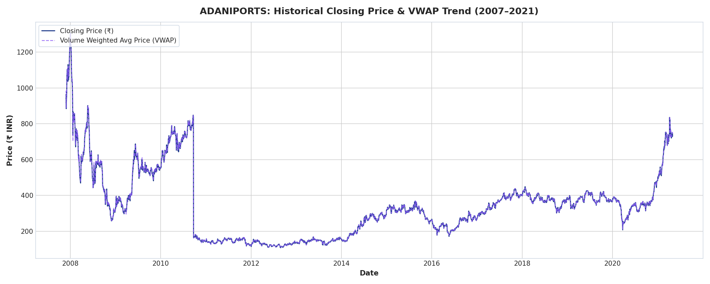
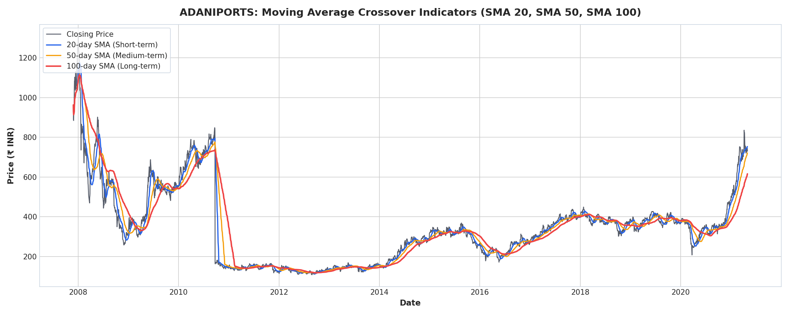
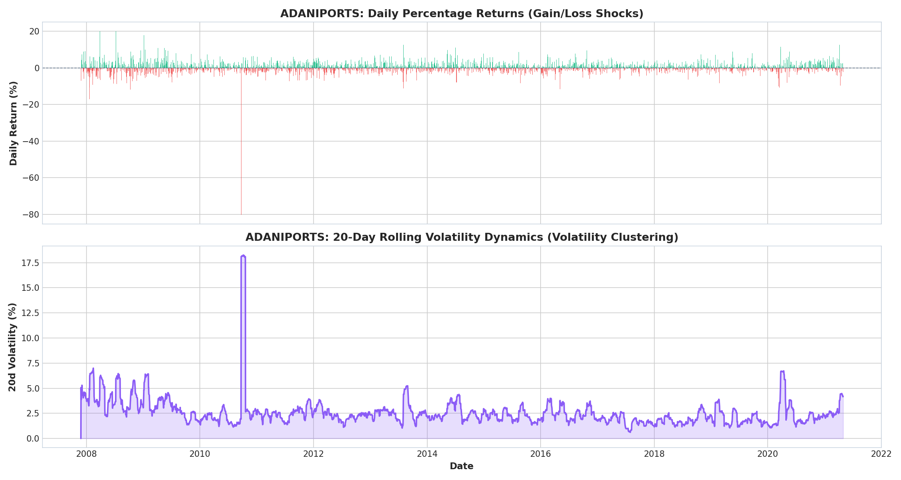
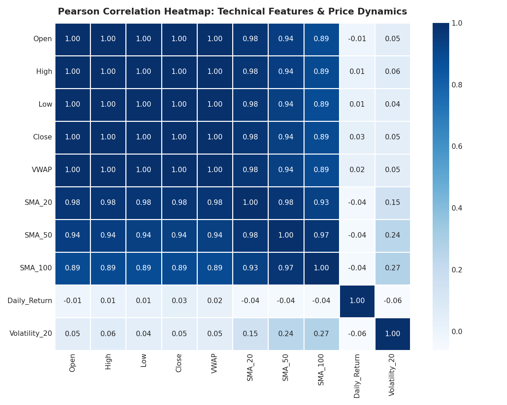
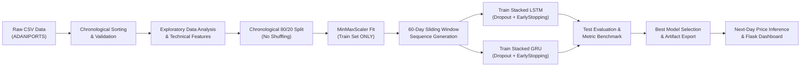
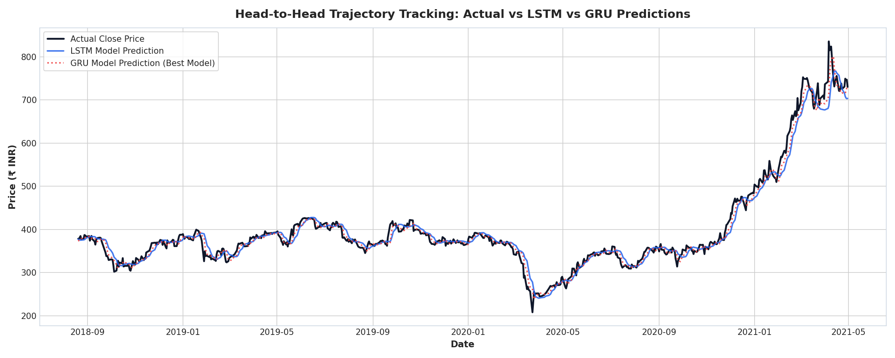
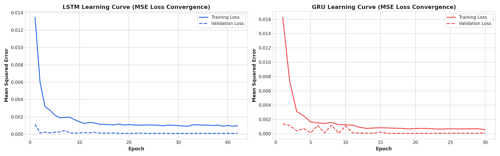
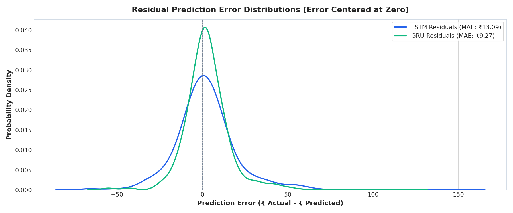

# Stock Price Prediction Using Deep Learning: LSTM and GRU Models
### *A Deep Learning-Based Time Series Analysis of ADANIPORTS Stock Prices*
**MBA Data Science & AI Academic Project, Live Demonstration & Viva Guide**

[](https://stock-price-prediction-lstm-gru-kfsvz4hfpur9atid684app7.streamlit.app)
[](https://colab.research.google.com/github/koundal-aryan/stock-price-prediction-lstm-gru/blob/main/notebooks/stock_prediction_analysis.ipynb)
[](notebooks/stock_prediction_analysis.ipynb)

---

> ### 🚀 Quick Access:
> * 🌐 **Live Cloud Dashboard (24x7 Online):** **[https://stock-price-prediction-lstm-gru-kfsvz4hfpur9atid684app7.streamlit.app](https://stock-price-prediction-lstm-gru-kfsvz4hfpur9atid684app7.streamlit.app)**
> * 📊 **Interactive Jupyter Notebook (All Executed Visuals):** [View Notebook with Outputs](notebooks/stock_prediction_analysis.ipynb) | [Open in Google Colab](https://colab.research.google.com/github/koundal-aryan/stock-price-prediction-lstm-gru/blob/main/notebooks/stock_prediction_analysis.ipynb)
> * 💻 **Local Flask Dashboard (When running locally):** [http://127.0.0.1:5001/dashboard](http://127.0.0.1:5001/dashboard)

---

## 1. Introduction
This project implements an end-to-end, production-grade Deep Learning system engineered to forecast stock prices using historical time-series data. Specifically centered on **ADANIPORTS (Adani Ports and Special Economic Zone Ltd.)**, the application processes 13.5 years of market transactions (2007–2021) to forecast the next trading day's closing price using two premier recurrent neural network architectures: **LSTM (Long Short-Term Memory)** and **GRU (Gated Recurrent Unit)**.

The solution encompasses clean data ingestion, exploratory econometrics, technical indicator computation, isolated normalization, sequential sliding-window construction, deep learning training with automated regularization, comprehensive model benchmarking, and an interactive **Flask analytics dashboard**.

---

## 2. Problem Statement
Predicting stock price movements is notoriously challenging in modern financial economics. According to the **Efficient Market Hypothesis (EMH)**, financial asset prices rapidly reflect all currently available public information, making future fluctuations behave closely to a stochastic random walk with high non-stationarity, regime shifts, and non-linear volatility clustering.

Traditional linear statistical methods (such as ARIMA, ARMA, and classical econometric regressions) struggle to capture complex non-linear temporal dependencies across varying time horizons. **Deep Learning architectures with recurrent gating mechanisms (LSTM and GRU)** are specifically investigated for their mathematical ability to maintain long-range temporal state representations, filter noisy microstructural fluctuations, and learn persistent momentum signatures over multi-month horizons without vanishing gradients.

---

## 3. Project Objectives
1. **Historical Data Ingestion:** Ingest and parse the official historical dataset of `ADANIPORTS` without hardcoded schema assumptions.
2. **Time-Series Integrity & Cleaning:** Enforce chronological ordering, handle missing values, eliminate duplicate timestamps, and validate price anomalies.
3. **Exploratory Financial Analysis (EDA):** Quantify asset dynamics including trend analysis, simple moving averages (20, 50, 100-day SMAs), daily percentage return distribution, and rolling volatility.
4. **Leakage-Free Feature Engineering:** Construct backward-looking technical indicators ensuring zero look-ahead bias.
5. **Sequential Modeling Pipeline:** Transform continuous time-series into sliding input windows of **60 trading days** mapped to the next trading day's closing price ($Close_{t+1}$).
6. **Deep Learning Architectures:** Implement, compile, and train stacked LSTM and stacked GRU networks with Dropout regularization and EarlyStopping.
7. **Rigorous Model Benchmarking:** Evaluate test performance across standard econometric regression metrics: MAE, MSE, RMSE, MAPE, and $R^2$ Score on unscaled Indian Rupee (₹) prices.
8. **Automated Model Selection:** Programmatically identify the superior model and save serialization artifacts.
9. **Next-Day Price Prediction:** Provide live inferential capability to project the subsequent trading session's close.
10. **Enterprise Web Dashboard:** Deliver a responsive, professional Flask web dashboard with interactive Plotly visual analytics.

---

## 4. Dataset Overview
- **Asset Name:** ADANIPORTS (Formerly Mundra Port & Special Economic Zone Ltd. - MUNDRAPORT)
- **File Name:** `ADANIPORTS-selected-columns-2.csv`
- **Total Records:** 3,322 Trading Days
- **Date Range:** November 27, 2007 to April 30, 2021 (~13.5 Years)
- **Detected Columns:**
  - `Date`: Trading day timestamp (converted to `datetime` and sorted chronologically)
  - `Symbol`: Ticker symbol (`MUNDRAPORT` in initial years, transitioning to `ADANIPORTS`)
  - `Series`: Equity series (`EQ`)
  - `Prev Close`: Preceding trading day's close price
  - `Open`: Opening price
  - `High`: Intraday high
  - `Low`: Intraday low
  - `Last`: Last traded price
  - `Close`: Official closing price (Primary target variable)
  - `VWAP`: Volume Weighted Average Price

### Exploratory Data Visualizations
<p align="center">
  
</p>
<p align="center">
  
</p>
<p align="center">
  
</p>
<p align="center">
  
</p>

---

## 5. Architectural Pipeline & Methodology



### Detailed Workflow:
1. **Raw Data Ingestion:** Dynamically locates and parses the dataset.
2. **Chronological Split:** Preserves temporal integrity using the first **80% of data for training** (2,597 sequences) and the subsequent **20% for testing** (665 trading sessions from August 2018 to April 2021).
3. **Data Scaling (Zero Leakage):** Fits `MinMaxScaler` exclusively on the training interval. The test interval is scaled strictly with the pre-fitted parameters.
4. **Sequence Generation:** 
   - Window size = **60 trading days** (~3 calendar months).
   - Input: $X = [Close_{t-59}, Close_{t-58}, \dots, Close_t]$
   - Output: $y = Close_{t+1}$
5. **Model Training:** Optimizes network weights using Adam optimizer, minimizing Mean Squared Error (MSE) with `EarlyStopping(patience=10)` and `ReduceLROnPlateau(factor=0.5, patience=5)`.
6. **Inference & Serving:** The lightweight inference engine loads the saved `.keras` model and `.pkl` scaler, generates predictions in sub-seconds, and serves them via Flask.

---

## 6. Deep Learning Architectures

### A. Long Short-Term Memory (LSTM)
Overcomes the vanishing gradient problem in standard RNNs through three specialized gating mechanisms:
- **Forget Gate ($f_t$):** Controls what past information to discard from the cell state.
- **Input Gate ($i_t$):** Determines which new inputs to incorporate into candidate memory.
- **Output Gate ($o_t$):** Regulates the filtered hidden output ($h_t$).
- **Architecture Stack:**
  - `Input(shape=(60, 1))`
  - `LSTM(64, return_sequences=True)`
  - `Dropout(0.2)`
  - `LSTM(32, return_sequences=False)`
  - `Dropout(0.2)`
  - `Dense(16, activation='relu')`
  - `Dense(1)`

### B. Gated Recurrent Unit (GRU)
A more compact and computationally efficient gating architecture introduced by Cho et al. (2014):
- **Reset Gate ($r_t$):** Governs how past hidden states are combined with new input.
- **Update Gate ($z_t$):** Jointly controls memory forgetting and candidate state addition.
- **Architecture Stack:**
  - `Input(shape=(60, 1))`
  - `GRU(64, return_sequences=True)`
  - `Dropout(0.2)`
  - `GRU(32, return_sequences=False)`
  - `Dropout(0.2)`
  - `Dense(16, activation='relu')`
  - `Dense(1)`

---

## 7. Model Benchmark & Empirical Results

The models were evaluated on the completely unseen test dataset spanning **665 trading days** (2018-08-20 to 2021-04-30). All metrics are calculated after inverse-transforming predictions back into real **Indian Rupees (₹)**:

| Model Architecture | MAE (₹) | MSE | RMSE (₹) | MAPE (%) | R² Score | Result |
| :--- | :---: | :---: | :---: | :---: | :---: | :---: |
| **LSTM** | ₹13.09 | 388.54 | ₹19.71 | 3.19% | 0.9666 | Baseline |
| **GRU** | **₹9.27** | **195.81** | **₹13.99** | **2.26%** | **0.9832** | **WINNER (Selected)** |

<p align="center">
  
</p>
<p align="center">
  
</p>
<p align="center">
  
</p>

### Analytical Insights:
- **Best Performer:** **GRU** outperformed LSTM across all regression error criteria, achieving lower RMSE (₹13.99 vs ₹19.71) and lower MAE (₹9.27 vs ₹13.09).
- **R² Fit:** An $R^2$ score of **0.9832** demonstrates that over 98% of variance in ADANIPORTS test prices is captured by the GRU recurrent states.
- **Mean Absolute Percentage Error (MAPE):** The GRU model achieved an average prediction error of just **2.26%** across 665 unseen test trading sessions.

---

## 8. Next-Day Price Prediction Example
Using the final 60 trading days in the dataset up to April 30, 2021:
- **Latest Observed Close:** **₹730.05** (April 30, 2021)
- **Predicted Next-Day Close:** **₹724.93** (GRU Model)
- **Expected Absolute Change:** **-₹5.12**
- **Expected Percentage Change:** **-0.70%**
- **Test Set Confidence ($R^2$):** **0.9832**

*(Note: Prediction is strictly a quantitative estimate and carries the standard financial market disclaimer).*

---

## 9. Project Directory Structure
```
stock_price_prediction/
│
├── app.py                     # Flask web server with analytics & inference routes
├── train.py                   # Automated end-to-end training pipeline script
├── predict.py                 # CLI inference pipeline for next-day close prediction
├── requirements.txt           # Python package dependencies
├── README.md                  # Comprehensive project documentation
│
├── data/
│   └── ADANIPORTS-selected-columns-2.csv # Historical stock dataset
│
├── models/
│   ├── lstm_model.keras       # Trained LSTM model weights
│   ├── gru_model.keras        # Trained GRU model weights
│   ├── scaler.pkl             # Fitted MinMaxScaler serialization
│   └── model_results.json     # Test metrics, training histories, & metadata
│
├── templates/
│   ├── base.html              # Core navigation layout, fonts, & Plotly JS CDN
│   ├── index.html             # Project executive summary & architecture cards
│   ├── dashboard.html         # Live analytics dashboard with KPI cards & charts
│   ├── analysis.html          # Exploratory Data Analysis & econometric stats
│   ├── models.html            # Head-to-head model benchmark & learning curves
│   └── prediction.html        # Next-day scenario forecaster & input window table
│
├── static/
│   ├── css/
│   │   └── style.css          # Modern FinTech responsive design system
│   └── js/
│       └── dashboard.js       # Dynamic Plotly resize & responsive UI interactions
│
├── utils/
│   ├── data_loader.py         # CSV loading, column auto-detection, date handling
│   ├── preprocessing.py       # Data validation, null handling, integrity report
│   ├── feature_engineering.py # SMAs, daily returns, volatility metrics
│   ├── sequence_generator.py  # Chronological 80/20 split & sliding window generator
│   ├── models.py              # LSTM & GRU architecture definitions & callbacks
│   ├── evaluation.py          # Regression metrics computation (MAE, RMSE, R2)
│   └── visualization.py       # Interactive Plotly charts (history, SMAs, returns)
│
└── notebooks/
    └── stock_prediction_analysis.ipynb # Interactive Jupyter exploration notebook
```

---

## 10. Installation & Quickstart Guide

### Step 1: Create and Activate Virtual Environment
```bash
# macOS / Linux
python3 -m venv venv
source venv/bin/activate

# Windows (Command Prompt)
python -m venv venv
venv\Scripts\activate

# Windows (PowerShell)
python -m venv venv
venv\Scripts\Activate.ps1
```

### Step 2: Install Required Dependencies
```bash
pip install -r requirements.txt
```

### Step 3: Run the Model Training Pipeline
To train both LSTM and GRU models from scratch, evaluate metrics, and save all model artifacts:
```bash
python train.py
```

### Step 4: Run CLI Next-Day Prediction (Optional)
To generate a next-day prediction directly in the terminal:
```bash
# Using best model (GRU)
python predict.py

# Or explicitly testing LSTM
python predict.py --model lstm
```

### Step 5: Start the Flask Web Application
```bash
python app.py
```
Open your browser and navigate to:
**`http://localhost:5000`** or **`http://127.0.0.1:5000`**

Available Web Routes:
- `/` — Project Overview, Architecture Pipeline & Highlights
- `/dashboard` — Live Analytics Dashboard, KPI Cards & Interactive Charts
- `/analysis` — Exploratory Data Analysis (EDA), Moving Averages & Volatility
- `/models` — LSTM vs. GRU Comparison Table, Learning Curves & Diagnostics
- `/predict` — Dedicated Next-Day Price Forecaster & 60-Day Lookback Sequence
- `/api/predict` — REST API endpoint returning JSON prediction payload

---

## 11. Limitations of the Model
In real-world financial markets, historical price sequences alone cannot guarantee future asset returns due to external systemic shocks:
1. **Unforeseen Breaking News:** Earnings surprises, credit rating revisions, and management changes occur instantaneously.
2. **Macroeconomic Shocks:** Interest rate decisions by the Reserve Bank of India (RBI), global inflation spikes, and crude oil prices alter port container demand.
3. **Geopolitical Events:** Tariff policies, international trade disruptions, and maritime shipping supply bottlenecks.
4. **Market Sentiment:** Social media sentiment, institutional block trades, and options market gamma squeezes introduce extreme non-linearities.

---

## 12. Future Scope & Enhancements
1. **Bidirectional LSTMs:** Processing sequences forward and backward to capture richer contextual patterns.
2. **CNN-LSTM Hybrid Networks:** Using 1D Convolutional layers to extract high-frequency local price patterns before feeding recurrent layers.
3. **Attention Mechanisms & Transformers:** Implementing multi-head self-attention architectures (such as PatchTST or Informer) designed specifically for long-horizon time series.
4. **Sentiment Analysis:** Scraping financial news headlines and Twitter/StockTwits feeds, processing sentiment via FinBERT or LLMs as an exogenous feature.
5. **Multi-Asset Modeling:** Co-training across the NIFTY 50 index and peer infrastructure firms to learn systemic cross-asset correlations.
